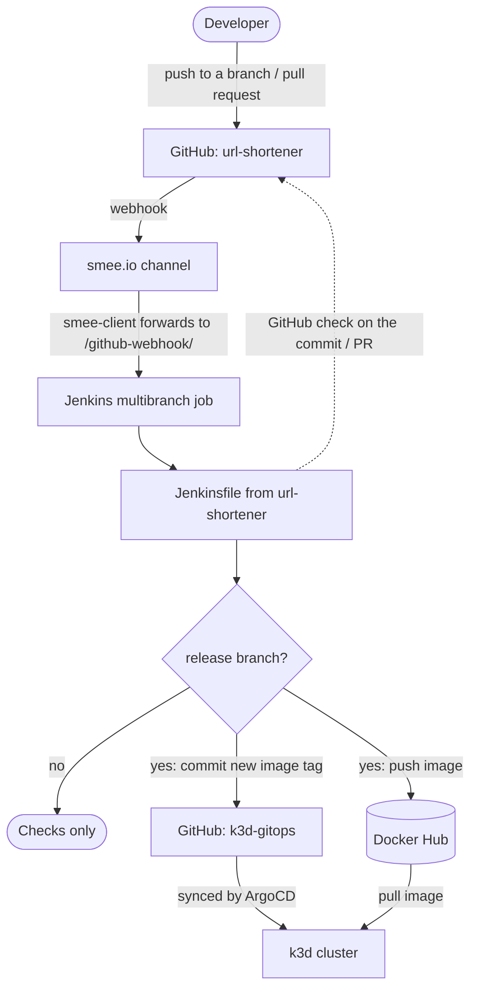

# jenkins-gitops

| Repository | Role | Relation to this repository |
|---|---|---|
| [jenkins-gitops](https://github.com/smallestcontainer/jenkins-gitops) | CI | This repository |
| [url-shortener](https://github.com/smallestcontainer/url-shortener) | Application | The service this Jenkins builds and checks; its `Jenkinsfile` defines the pipeline run here |
| [k3d-gitops](https://github.com/smallestcontainer/k3d-gitops) | CD | Kubernetes manifests that deploy the image built by this Jenkins |

A self-contained Jenkins CI server, defined as code, that builds and checks the
[url-shortener](https://github.com/smallestcontainer/url-shortener) application.

Jenkins is fully configured at startup: plugins, the admin user, credentials, the
GitHub integration and the pipeline job itself are all created from files in this
repository. The setup wizard is disabled, and nothing needs to be configured by hand in the UI.

## Architecture

This repository is the CI part of a GitOps pipeline:



Every push to a branch and every pull request in `url-shortener` triggers the pipeline.
GitHub delivers the webhook through [smee.io](https://smee.io), so Jenkins does not have
to be reachable from the internet. The result is reported back as a GitHub check:
a red check blocks the pull request until the issues are fixed.

Builds of the release branch (set in the `when { branch … }` conditions of the
`Jenkinsfile`) go further: Jenkins pushes the image to Docker Hub, tagged with the short
commit hash, then updates that tag in `kustomization.yaml` of
[k3d-gitops](https://github.com/smallestcontainer/k3d-gitops) with `kustomize edit set image`
and pushes the commit to its `master`. ArgoCD picks up the commit and rolls out the new
image to the cluster.

### Repository structure

```
jenkins-gitops/
├── compose.yaml            # Jenkins + smee webhook relay
├── .env                    # Non-secret settings (in .gitignore)
└── jenkins/
    ├── Dockerfile          # Jenkins image with the Docker CLI and bundled plugins
    ├── plugins.txt         # Plugin list with pinned versions, installed at build time
    ├── jenkins.yaml        # Configuration as Code (JCasC): users, credentials, GitHub
    ├── pipeline.groovy     # Job DSL: creates the multibranch pipeline job
    └── secrets/            # Secret files (in .gitignore), see below
```

### Ports and storage

| Setting | Value |
|---|---|
| Web UI | `8080` |
| Inbound agent port | `50000` |
| Home directory volume | `pet-jenkins_home` (build history and workspaces) |
| Network | `net-cli` (bridge, shared by `jenkins` and `smee`) |

### Credentials created in Jenkins

| ID | Type | Source |
|---|---|---|
| `github-app` | GitHub App | `appID` in `jenkins.yaml` + `secrets/github-app-key.pem`; used for repository scans, GitHub checks and pushing image tags to `k3d-gitops` |
| `dockerhub` | Username / password | `DOCKERHUB_USERNAME` + `secrets/dockerhub.token` |

## Installation

### Requirements

- Docker Engine with the Compose plugin
- A GitHub App installed on the `url-shortener` and `k3d-gitops` repositories with
  permissions for contents (read/write: Jenkins pushes image tags to `k3d-gitops`),
  checks (read/write), pull requests (read) and commit statuses
- A Docker Hub account and an access token
- A smee.io channel (open https://smee.io/new and copy the channel ID)

### 1. Clone

```bash
git clone git@github.com:smallestcontainer/jenkins-gitops.git
cd jenkins-gitops
```

### 2. Create `.env`

```dotenv
CASC_JENKINS_CONFIG=/var/jenkins_home/jenkins.yaml

SMEE_TOKEN=<your smee.io channel ID>
JENKINS_URL=http://jenkins:8080

REPOSITORY_OWNER=smallestcontainer
REPOSITORY_NAME=url-shortener

DOCKERHUB_USERNAME=<your Docker Hub username>
```

`JENKINS_URL` must be reachable from the `smee` container, so use the Compose
service name (`jenkins`), not `localhost`.

### 3. Create the secret files

```bash
mkdir -p jenkins/secrets

# Jenkins admin login
cat > jenkins/secrets/.env-admin <<'EOF'
JENKINS_ADMIN_USERNAME=admin
JENKINS_ADMIN_PASSWORD=<strong password>
EOF

# GitHub App private key (downloaded from the GitHub App settings page).
# Jenkins requires PKCS#8; convert the key if GitHub gave you PKCS#1:
openssl pkcs8 -topk8 -inform PEM -outform PEM -nocrypt \
  -in <downloaded-key>.pem -out jenkins/secrets/github-app-key.pem

# Docker Hub access token
printf '%s' '<docker hub token>' > jenkins/secrets/dockerhub.token

chmod 600 jenkins/secrets/*
```

Both `.env` and `jenkins/secrets/` are in `.gitignore` and excluded from the Docker
build context.

### 4. Adjust host-specific values

- **docker group ID.** `compose.yaml` adds the container to group `989` so the
  `jenkins` user can access the Docker socket. Check the GID on your host
  and replace it if needed:
  ```bash
  getent group docker | cut -d: -f3
  ```
  The same GID is set in the Trivy stage of the `url-shortener` `Jenkinsfile`.
- **GitHub App ID.** `appID` in `jenkins/jenkins.yaml` is `4906085`. Replace it with
  your app's ID.
- **Repository.** `repoOwner` and `repository` are set in `jenkins/pipeline.groovy`.

### 5. Configure the GitHub webhook

In the webhook settings of the GitHub App (or the repository), set:

- **Payload URL:** `https://smee.io/<SMEE_TOKEN>`
- **Content type:** `application/json`
- **Events:** pull requests, pushes, check runs

### 6. Start

```bash
docker compose up -d --build
```

Open http://localhost:8080 and log in with the credentials from `.env-admin`.
The `Image Jenkins Multibranch` job is created automatically and scans the repository.

## Removal

```bash
docker compose down              # remove containers and network (build history is kept in the volume)
docker compose down -v --rmi local   # also delete the pet-jenkins_home volume and the built Jenkins image
```

Remove the webhook from the GitHub App (or repository) settings and, if no longer
needed, uninstall the GitHub App and revoke the Docker Hub access token.
